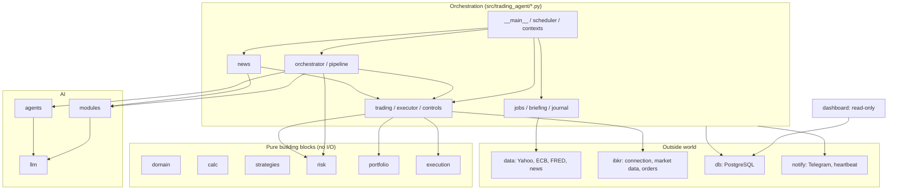

# Code map

What each part of the code does, where to find it and how the parts work together. For what the system does in plain language, see [HOW-IT-WORKS.md](HOW-IT-WORKS.md); for what runs when, see [RUNTIME.md](RUNTIME.md); for the multi-agent design, see [MAS-DESIGN.md](MAS-DESIGN.md).

**Contents**

1. [The big picture](#1-the-big-picture)
2. [One stock through the code](#2-one-stock-through-the-code)
3. [Rules the code follows](#3-rules-the-code-follows)
4. [`src/trading_agent`, file by file](#4-srctrading_agent-file-by-file)
5. [Outside `src/`](#5-outside-src)
6. [Where to change what](#6-where-to-change-what)

---

## 1. The big picture

About 13,600 lines of Python in `src/trading_agent` (plus 9,300 lines of tests), in two kinds of code:

- **Orchestration** (the 17 files directly in `src/trading_agent/`, about 4,100 lines): decides *when* and *in which order* things happen, talks to the database, Telegram and the AI providers, and wires everything together.
- **Building blocks** (the 14 folders): each does one kind of work. Most of them are **pure**: no database, no network, no clock, so they can be tested exactly.

| Folder | Files / lines | In one sentence |
|---|---|---|
| `domain/` | 12 / 640 | The shared data types (instrument, bar, proposal, order, risk decision, step, news item). No logic, no I/O. |
| `calc/` | 8 / 650 | Calculations: indicators, price levels, trend, macro snapshot, fees, position size, stop moves. |
| `strategies/` | 3 / 160 | The screen's pullback rules and the thresholds for news trades. |
| `data/` | 8 / 750 | Fetching data from outside (Yahoo, ECB, FRED, Finnhub/Yahoo news), loading it into the database, checking its quality, exchange calendars. |
| `db/` | 14 / 1,650 | The database: table definitions and one file of reads/writes per topic. |
| `llm/` | 10 / 870 | Running any AI call safely: model choice, budget, cache, pacing, validation, retry, recording, tracing, prompts. |
| `modules/` | 5 / 680 | The three analysis agents that read data: technical analyst, earnings analyst, News agent. |
| `agents/` | 3 / 220 | The two deciding agents: proposer and critic. |
| `risk/` | 4 / 470 | The risk engine (9 checks, position size) and the kill switch. Never uses AI. |
| `execution/` | 4 / 240 | Orders without I/O: how a bracket order looks, the broker interface, the order state machine, comparing IBKR's positions with the book. |
| `ibkr/` | 4 / 660 | **Everything that talks to IBKR**: the gateway connection with reconnects and reconciliation, market data (contracts, tick sizes, quotes, bars) and the order adapter. |
| `portfolio/` | 5 / 430 | Accounting: cash, positions, P&L in EUR, market facts for the risk engine, trade statistics, tax report. |
| `notify/` | 4 / 780 | Telegram bot, every message text, heartbeat ping. |
| `dashboard/` | 5 / 1,280 | The read-only Streamlit website. |

---

## 2. One stock through the code

What happens to one stock, say AAPL, on a normal day, with the file that does each step:

| Time (Berlin) | Step | Code |
|---|---|---|
| 14:15 | News on AAPL is fetched (Finnhub) and read by the News agent; a confident `buy` is stored as a signal | `news.scan_news` → `data/news.py` → `modules/news.py` (via `llm/runner.py`) → `db/steps.py` |
| 14:45 | The screen checks AAPL against the pullback rules (or the basic rules, if it has a news signal) | `orchestrator.scan` → `pipeline.screen_stocks` → `screen.py` + `strategies/pullback.py` |
| 14:45 | Technical and earnings analysts | `pipeline.analyse` → `modules/technical.py`, `modules/earnings.py` (indicators from `calc/`) |
| 14:45 | Proposer decides: buy (at which levels) or pass; critic looks for reasons not to | `orchestrator.scan` → `pipeline.proposer_input` → `agents/proposer.py`, `agents/critic.py` |
| 14:45 | Ranked by confidence × R:R and stored as a proposal; every step written to the step log | `pipeline.rank`, `db/proposals.py`, `db/steps.py` |
| 15:45 | Risk engine: 9 checks and the number of shares | `orchestrator.place` → `trading.decide` → `risk/engine.py` (facts from `portfolio/`) |
| 15:45 | Bracket order (buy limit + stop + target) sent to IBKR | `executor.submit` → `execution/orders.py` → `ibkr/orders.py` |
| every 10 min | IBKR's order status and fills come back; 🟢 when bought | `orchestrator.monitor` → `trading.sync` → `executor.sync` → `execution/fsm.py` |
| every 30 min | News on the held stock; a confident `exit` sells at the market | `news.watch_positions` → `modules/news.py` → `executor.request_exit` |
| 22:35 | Stop to breakeven / trailing, time stop, book and loss limits | `orchestrator.end_of_day` → `calc/stops.py`, `executor.move_stop`, `trading.rebuild_book` → `portfolio/book.py` |
| any time | You see it all on the dashboard (Day page) and in Telegram | `dashboard/`, `notify/messages.py` |

---

## 3. Rules the code follows

Enforced by `import-linter` in CI (`pyproject.toml`, `[tool.importlinter]`), so breaking them fails the build:

| Rule | Why |
|---|---|
| `llm`, `modules` and `agents` can't import `execution`, `ibkr` or `risk` | AI code has no path to an order; it can only return data |
| `risk` can't import `llm`, `modules` or `agents` | The risk engine is deterministic |
| Only the orchestration layer imports `execution` and `ibkr` | Orders are placed in one controlled place (`executor.py`) |
| `domain` imports nothing of the app | The shared types stay plain |
| `dashboard` can't import `risk`, `llm`, `agents`, `notify`, `scheduler`, `execution` or `ibkr` | The website can only read |

Further conventions:

- **Pure where possible.** `domain`, `calc`, `strategies`, `risk`, `portfolio`, `execution` and `dashboard/frames.py` have no I/O; the caller passes every fact in. `pyright` checks `domain`, `calc`, `risk`, `execution` and `ibkr/orders.py` in strict mode.
- **100 % branch coverage** for `risk`, `execution` and `ibkr/orders.py` (`make test` fails below that).
- **All IBKR code is in `ibkr/`**; everything else talks to IBKR only through it.
- **Prices are `Decimal`** in domain types and the database; calculators convert to `float`.
- **Every AI call goes through `llm/runner.py`**: no other code calls a model.
- **Untrusted text** (news) is wrapped by `llm/sanitize.py` before it reaches a prompt.

---

## 4. `src/trading_agent`, file by file

### 4.1 Orchestration (files directly in `src/trading_agent/`)

| File | What it does |
|---|---|
| `__main__.py` | The command line (`trading-agent ...`): `run` (starts the agent), `backfill`, `quality`, `analyse`, `propose`, `place`, `ibkr-check`, `tax-report`, `reset`, `dashboard`. Each command loads the settings, opens the database and calls the matching function below. |
| `scheduler.py` | The agent's main loop (`serve`): builds the contexts, starts Telegram and the IBKR link, plans the jobs from `config/schedule.yaml` (`build_scheduler`, `plan_session_jobs`: session jobs are planned each day at 00:05 from the exchange calendars) and maps each job name to its function (`job_functions`). Alerts on failed or missed jobs. |
| `orchestrator.py` | **The trading day, stage by stage**: `scan` (screen + news candidates → technical → earnings → proposer → critic → rank → proposals), `place` (risk engine → bracket at IBKR, at most 1 news trade a day), `monitor` (IBKR sync), `end_of_day` (stop moves, time stops, book, loss limits). Start reading here. |
| `news.py` | **The news stages**: `scan_news` (before each scan: news on every stock not held → buy signals) and `watch_positions` (every 30 min: news on held stocks → exit at the market, or advice). Fetching, batching, acting on the News agent's answer. |
| `pipeline.py` | Building blocks of the scan: `screen_stocks` (the screen with blocked, blacklisted and held stocks dropped, plus news candidates), `analyse` (technical and earnings analyst per stock), the proposer's input, turning the agents' answers into a `Proposal`, the ranking (confidence × R:R), the macro snapshot, and the step-log entries for each phase. |
| `screen.py` | The screen: every stock's verdict against the pullback rules (or only the basic rules for news candidates), with the first rule it fails; selecting the top N; merging pullback and news candidates. |
| `trading.py` | What `place`, `monitor` and `end_of_day` build on: `TradingContext`, loading the book from brackets and fills, the risk decision for one proposal (`decide`), the IBKR sync with 🟢 🔴 ⌛ alerts, rebuilding the book and checking loss limits at the close, and the Telegram commands `/positions`, `/pnl`, `/exit`. |
| `executor.py` | The only code that creates orders: `submit` (bracket), `sync` (IBKR's order states and fills → state machine), `cancel_entry`, `request_exit`, `move_stop`. Writes the order, broker, fill, stop, exit and cancel steps, including IBKR's error text. Safe to repeat: orders are keyed by their `orderRef`. |
| `controls.py` | The kill switch at runtime (`ControlCenter`): `/pause`, `/resume`, `/stop`, `/reset`, `/confirm_live`, loss-limit trips, the live-mode interlock. |
| `contexts.py` | The shared setup objects, built once at start or per CLI command: `RuntimeState` (what `/status` shows), `DataContext` (data providers), `BookContext` (rules, fees, benchmarks), `AnalysisContext` (AI runner, agents, screen rules). |
| `jobs.py` | The data jobs: prices after each close (`eod`), macro, earnings, `backfill`, the quality check with its ⚠️ alert, and the yearly `tax_report`. |
| `briefing.py` | The 📰 morning briefing and the answers to `/status` and `/budget`. |
| `journal.py` | Telegram `/proposals`, `/why`, `/review` (your labels) and the 🌙 evening digest. |
| `settings.py` | All settings: `.env` and Docker secrets (`Settings`), and typed views of `config/schedule.yaml`, `data.yaml`, `fees.yaml`. |
| `telemetry.py` | AI tracing: OpenTelemetry setup and export to Langfuse ([OBSERVABILITY.md](OBSERVABILITY.md)). |
| `log.py` | Structured JSON logging; adds the trace id to log lines written during an AI run. |

### 4.2 `domain/`: shared types

| File | Contents |
|---|---|
| `market.py` | `Instrument`, `Bar`, `BarSeries`, `EarningsEvent`, `Observation` (FX, macro), `Market` (`US`/`EU`), tick increments |
| `proposals.py` | `Proposal` (status, prices, confidence, rank, strategy, thesis) and your labels |
| `orders.py` | `BracketRequest`, `OrderSpec`, `BrokerOrder`, `BrokerFill`, `Bracket` and its events; `order_ref` builds `TA-<symbol>-<kind>-<id>` |
| `risk.py` | Risk engine input and output: `Controls`, `PortfolioState`, `MarketSnapshot`, `Check`, `RiskDecision` |
| `steps.py` | `Step`: one phase of one stock on one day (the step log) |
| `trading.py` | `Trade` (a round trip) and `Book` (`agent_paper`, `agent_live`) |
| `news.py` | `NewsItem` with its relevance |
| `analysis.py` | Records of AI runs and calls, validation issues |
| `levels.py` | Named price levels (the menu the AI picks from) |
| `broker.py` | Account values and positions as IBKR reports them |
| `numbers.py` | Float → Decimal at fixed places |

### 4.3 `calc/`: calculations

| File | Contents |
|---|---|
| `indicators.py` | SMA, EMA, RSI, MACD, ATR, Bollinger |
| `levels.py` | Swing points, support/resistance zones, Fibonacci, and the **level menu** (`close`, `ema20`, `atr_stop_2x`, `resistance_1`, ...) |
| `trend.py` | Trend state (daily/weekly), relative strength, reactions after earnings |
| `macro.py` | Macro snapshot for the proposer (benchmark trend, VIX, yields, credit spreads) |
| `fees.py` | IBKR commissions per market (from `config/fees.yaml`) |
| `sizing.py` | Position size: risk, position and cash limits, scaled by confidence |
| `stops.py` | Breakeven and ATR trailing stop (stops only move up) |

### 4.4 `strategies/`: rules

| File | Contents |
|---|---|
| `pullback.py` | The pullback rules (price, liquidity, trend, dip, RSI, earnings buffer) and trade-management parameters (entry validity, breakeven, time stop, trailing); read from `config/strategies.yaml` |
| `news.py` | `NewsParams`: confidence thresholds and limits for news trades (`config/strategies.yaml` → `news:`) |

### 4.5 `data/`: the outside world, read side

| File | Contents |
|---|---|
| `ingest.py` | Loading into the database, idempotent and incremental: prices (with restatement detection), FX, macro, earnings, universe sync, quality run |
| `yahoo.py` | Daily bars and earnings dates via yfinance |
| `series.py` | ECB (EUR/USD, deposit rate) and FRED (US macro) |
| `news.py` | Company news: `FinnhubNews` (US), `YahooNews` (EU) |
| `quality.py` | Data checks: missing sessions, bad prices, jumps, zero volume, stale data |
| `calendars.py` | Exchange sessions (holidays, half-days, DST) for XETR and XNYS |
| `universe.py` | Reads `config/universe.yaml` |

### 4.6 `db/`: the database

`models.py` defines every table; `session.py` creates the connection. One file per topic for reads and writes:

| File | Tables |
|---|---|
| `market.py` | `instruments`, `bars_daily`, `fx_daily`, `macro_series`, `earnings_events` |
| `proposals.py` | `proposals`, `user_labels` |
| `steps.py` | `steps` (the step log; also the news buy signals) |
| `orders.py` | `brackets`, `orders`, `fills` |
| `book.py` | `risk_decisions`, `equity_daily` |
| `trades.py` | `trades` |
| `analyses.py` | `analyses` (every AI answer, also the cache), `llm_calls` (every attempt with messages and cost) |
| `news.py` | `news` |
| `controls.py` | `kill_switch` |
| `reports.py` | `reports` (tax) |
| `audit.py` | `audit_log` |

The schema changes only through Alembic migrations (`migrations/versions/`).

### 4.7 `llm/`: running AI calls

| File | Contents |
|---|---|
| `runner.py` | **Every AI call**: cache lookup → budget check → pacing → call → validators → one corrective retry → store (`analyses`, `llm_calls`) → trace |
| `models.py` | `config/models.yaml`: role → model, prices, rate limits, scan size |
| `budget.py` | Monthly budget: normal, lean (80 %), stopped (100 %) |
| `prompts.py` | Loads `prompts/<agent>/v<N>.md` |
| `validators.py` | Shared checks: price order, R:R, stop distance, numbers that aren't in the input |
| `sanitize.py` | Wraps and cleans untrusted text (news) |
| `tracing.py` | Span names and attributes for Langfuse |
| `fake.py` | The offline fake model (`LLM_FAKE=true`, dev stack only) |
| `store.py` | In-memory store for the evals |

### 4.8 `modules/` and `agents/`: the AI agents

Each agent is one file with its input type, output type, `validate` (code checks after every answer) and `finalize`. The prompt is in `prompts/`.

| File | Agent | Model role |
|---|---|---|
| `modules/technical.py` | Technical analyst: indicators, trend and the level menu in; rating, setup quality and a draft plan out | `analysis` |
| `modules/earnings.py` | Earnings analyst: next report vs. the holding window, past surprises and reactions | `analysis` |
| `modules/news.py` | News agent: headlines (and position facts for held stocks) in; relevance per headline and `buy` / `exit` / `none` per stock out | `triage` |
| `modules/history.py` | Loads the data one analysis needs, cut at the scan date (no look-ahead) | |
| `agents/proposer.py` | Proposer: propose (entry, stop, target from the menu) or pass | `proposer` |
| `agents/critic.py` | Critic: objections, severity, confidence change | `critic` |

### 4.9 `risk/`: the risk engine

| File | Contents |
|---|---|
| `engine.py` | `evaluate`: the 9 checks (global state, instrument, levels, sizing, fees, portfolio, loss limits, rate limits) and the number of shares; `loss_trips` at the close |
| `config.py` | Typed `config/risk.yaml` |
| `kill_switch.py` | Kill-switch transitions (active, paused, halted) |

### 4.10 `execution/`: orders, without I/O

| File | Contents |
|---|---|
| `orders.py` | What a bracket looks like (entry limit, stop, target; OCA group) and the `OrderBroker` interface every broker implements |
| `fsm.py` | The bracket's state machine: submitted → working → filled → exiting → closed (or expired, cancelled) |
| `reconcile.py` | IBKR positions vs. the book |

### 4.11 `ibkr/`: everything that talks to IBKR

| File | Contents |
|---|---|
| `link.py` | The IB Gateway connection (`BrokerLink`): connects, checks every 30 s, reconnects with backoff, 🔌 after 10 min down. On every (re)connect: contract ids (`sync_conids`) and reconciliation (`reconcile_positions`: IBKR positions vs. the book; any difference halts). Also `check` for `trading-agent ibkr-check`. |
| `orders.py` | `IbkrBroker`, the `OrderBroker` for IBKR: places, cancels and modifies orders, reads orders, fills, positions and account values, and IBKR's error messages |
| `market.py` | Market data: contract ids, tick increments (`MarketInfo`), quotes, daily bars (optional, `config/data.yaml`), request pacing |

### 4.12 `portfolio/`: accounting

| File | Contents |
|---|---|
| `portfolio/book.py` | The account from brackets and fills: cash (with settlement days), positions, equity, day/week P&L, drawdown, round-trip trades |
| `portfolio/snapshot.py` | Market facts for the risk engine: mid price, ATR, liquidity, earnings distance, correlations; rounding to IBKR's tick sizes |
| `portfolio/tax.py` | Realized gains and losses in EUR per sale, for Anlage KAP |
| `portfolio/kpi.py` | Trade statistics for the dashboard (win rate, expectancy, ...) |

### 4.13 `notify/` and `dashboard/`

| File | Contents |
|---|---|
| `notify/telegram.py` | The bot: long polling, only your chat, commands and buttons; a log-only fallback without a token |
| `notify/messages.py` | Every Telegram text (pure functions) |
| `notify/heartbeat.py` | The ping to healthchecks.io |
| `dashboard/app.py` | Entry point (`trading-agent dashboard`) |
| `dashboard/pages.py` | The pages: Day, Portfolio, Costs, Risk |
| `dashboard/queries.py` | Read-only SQL for the pages |
| `dashboard/frames.py` | Pure table transforms (day table, funnel, positions, KPIs) |

---

## 5. Outside `src/`

| Path | Contents |
|---|---|
| `config/` | Settings in YAML: `risk.yaml` (limits), `strategies.yaml` (screen, trade management, news), `models.yaml` (AI models, budget), `schedule.yaml` (when jobs run), `universe.yaml` (the stocks), `data.yaml` (sources, quality), `fees.yaml`. Every setting is explained in [HOW-IT-WORKS.md](HOW-IT-WORKS.md) section 12. |
| `prompts/` | One folder per agent, one file per prompt version (`v1.md`, ...). Older versions stay for comparison; the code names the version in use (`PROMPT_VERSION`). |
| `migrations/` | Alembic database migrations, `0001` to `0014`; `make migrate` applies them |
| `scripts/` | `build_universe.py` (refresh `universe.yaml`), `export_eval_cases.py` (record eval cases), `backup.sh`, `restore.sh` |
| `docker/db/init/` | Creates the database roles (`agent`, read-only `dashboard`) on a fresh database |
| `tests/unit/` | Fast tests without a database (`make test`) |
| `tests/integration/` | Tests against a throwaway Postgres (`make test-db`); `tests/fake_broker.py` stands in for IBKR |
| `tests/evals/` | AI golden cases against the real models (`uv run pytest -m llm tests/evals`) |
| `compose.yaml`, `Dockerfile`, `Makefile` | The containers and the commands to run them ([ZENBOOK.md](ZENBOOK.md)) |
| `compose.dev.yaml` | Local stack with the fake model, no IBKR (`make dev-up`) |

---

## 6. Where to change what

| You want to change | Change | Code that reads it |
|---|---|---|
| A limit (positions, risk per trade, loss limits) | `config/risk.yaml` | `risk/config.py`, `risk/engine.py` |
| The screen rules, breakeven, time stop, trailing | `config/strategies.yaml` → `pullback:` | `strategies/pullback.py` |
| News thresholds | `config/strategies.yaml` → `news:` | `strategies/news.py`, `news.py`, `orchestrator.py` |
| When a job runs | `config/schedule.yaml` | `scheduler.py` |
| A model or the AI budget | `config/models.yaml` | `llm/models.py`, `llm/budget.py` |
| What an agent is told | New file `prompts/<agent>/v<N+1>.md`, then `PROMPT_VERSION` in the agent's file | `llm/prompts.py` |
| What an agent sees | The agent's input type in `modules/` or `agents/`, filled in `pipeline.py` or `news.py` | |
| A Telegram text | `notify/messages.py` | |
| A dashboard page | `dashboard/pages.py` (+ `queries.py`, `frames.py`) | |
| The stocks | `scripts/build_universe.py` → `config/universe.yaml` | `data/universe.py`, `data/ingest.py` |
| A table | New migration in `migrations/versions/` and `db/models.py` | |
