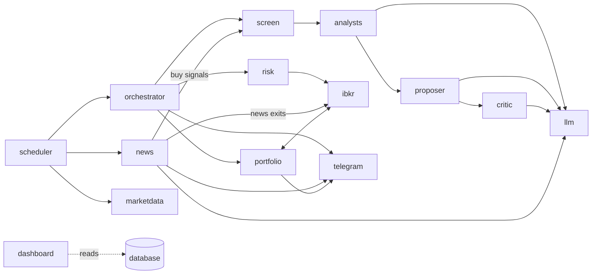

# Code map

What each part of the code does and where to find it. The code is organised **by component**: one folder per part of the system (market data, news, the screen, the analysts, the proposer, the critic, the risk engine, IBKR, the portfolio, Telegram, ...). What the system does is in [HOW-IT-WORKS.md](HOW-IT-WORKS.md); how to run it is in [MANUAL.md](MANUAL.md).

**Contents**

1. [The layout](#1-the-layout)
2. [The components](#2-the-components)
3. [One stock through the code](#3-one-stock-through-the-code)
4. [Rules the code follows](#4-rules-the-code-follows)
5. [Each component, file by file](#5-each-component-file-by-file)
6. [Outside `src/`](#6-outside-src)
7. [Where to change what](#7-where-to-change-what)

---

## 1. The layout

About 13,600 lines of Python in `src/trading_agent/` (plus 9,500 lines of tests).

```
src/trading_agent/
├── orchestrator.py   the trading day, stage by stage: scan, place, monitor, end of day
├── scheduler.py      when each stage runs; starts everything (`trading-agent run`)
├── contexts.py       the shared setup each stage gets (settings, data sources, agents, rules)
├── __main__.py       the command line (`trading-agent ...`)
│
├── marketdata/       prices, FX, macro, earnings dates, calendars, universe, data quality
├── news/             Finnhub and Yahoo headlines, the News agent, buy signals and news exits
├── screen/           the pullback rules and the daily candidate list
├── analysts/         the technical and earnings analysts (AI) and the price-level menu
├── proposer/         the proposer (AI), the proposals and the ranking
├── critic/           the critic (AI)
├── risk/             the risk engine, position size, kill switch
├── ibkr/             everything that talks to IBKR: connection, market data, orders, executor
├── portfolio/        the agent's book: positions, P&L in EUR, stops, fees, trades, tax
├── telegram/         the bot, every message, morning briefing, evening digest, heartbeat
├── dashboard/        the read-only website
├── llm/              shared AI plumbing: the runner every AI call goes through
└── core/             shared plumbing: settings, database, step log, logging, tracing
```

Inside a component the files follow the same pattern, so you know where to look:

| File | Holds |
|---|---|
| `types.py` | The component's data: plain types, no database, no network (e.g. `marketdata/types.py`: `Instrument`, `Bar`; `proposer/types.py`: `Proposal`) |
| `store.py` | The component's database reads and writes (e.g. `proposer/store.py`: save and load proposals) |
| `agent.py` | The AI agent, if the component has one: its input, its output, the code checks after every answer |
| `stage.py` | What the component does in the trading day, called by `orchestrator.py` or the scheduler, including the steps it writes to the step log |
| other files | The component's logic (e.g. `risk/engine.py`, `screen/screen.py`, `ibkr/link.py`) |

---

## 2. The components

| Component | Files / lines | In one sentence | AI? |
|---|---|---|---|
| `marketdata/` | 13 / 1,490 | Fetches daily prices (Yahoo), FX and the ECB rate, US macro (FRED) and earnings dates, stores them, checks their quality, knows the exchange calendars and computes indicators. | |
| `news/` | 7 / 730 | Fetches company news (Finnhub for US, Yahoo for EU), lets the News agent read it, and turns its answers into buy signals and news exits. | ✓ |
| `screen/` | 4 / 430 | Checks every stock against the pullback rules (or the basic rules for news candidates) and picks the day's candidates. | |
| `analysts/` | 7 / 840 | The technical analyst and the earnings analyst, the facts they get (indicators, the level menu, past reports) and the analyst stage. | ✓ |
| `proposer/` | 5 / 520 | The proposer: its input, turning its answer (and the critic's) into a proposal, ranking by confidence × R:R, storing proposals. | ✓ |
| `critic/` | 3 / 110 | The critic: looks for reasons not to take a proposal. | ✓ |
| `risk/` | 9 / 1,080 | The risk engine (9 checks, position size), its limits from `risk.yaml`, the kill switch with its Telegram commands, and the decision for each proposal. Never uses AI. | |
| `ibkr/` | 11 / 1,660 | The IB Gateway connection, market data from IBKR, the order adapter, bracket orders, the order state machine, the executor and the reconciliation. The only component that talks to IBKR. | |
| `portfolio/` | 10 / 1,100 | The agent's book from IBKR's fills: positions, cash, P&L in EUR, stop moves, fees, round trips, the tax report, and `/positions`, `/pnl`, `/exit`. | |
| `telegram/` | 6 / 1,110 | The bot (only your chat), every message text, the morning briefing, `/proposals`, `/why`, `/review`, the evening digest, the heartbeat. | |
| `dashboard/` | 5 / 1,280 | The read-only Streamlit website: Day, Portfolio, Costs, Risk. | |
| `llm/` | 12 / 1,030 | Runs every AI call safely: model choice, budget, cache, pacing, validation, one retry, recording, tracing, prompts. | |
| `core/` | 10 / 900 | Settings, database connection and tables, the step log, logging, tracing setup. | |
| top level | 4 / 1,390 | `orchestrator.py`, `scheduler.py`, `contexts.py`, `__main__.py` | |



---

## 3. One stock through the code

What happens to one stock, say AAPL, on a normal day:

| Time (Berlin) | Step | Code |
|---|---|---|
| 22:30 the day before | Closing prices are stored and checked | `marketdata/jobs.eod` → `marketdata/ingest.py`, `marketdata/quality.py` |
| 14:15 | News on AAPL is fetched and read by the News agent; a confident `buy` is stored as a buy signal | `news/stage.scan_news` → `news/sources.py` → `news/agent.py` (via `llm/runner.py`) → `core/step_store.py` |
| 14:45 | The screen checks AAPL against the pullback rules (or the basic rules, with a news signal) | `orchestrator.scan` → `screen/stage.screen_stocks` → `screen/screen.py`, `screen/rules.py` |
| 14:45 | Technical and earnings analysts | `analysts/stage.analyse` → `analysts/technical.py`, `analysts/earnings.py` (level menu from `analysts/levels.py`) |
| 14:45 | Proposer: buy (at which levels) or pass | `proposer/stage.proposer_input` → `proposer/agent.py` |
| 14:45 | Critic: reasons not to | `critic/agent.py`, `critic/stage.critic_step` |
| 14:45 | Ranked by confidence × R:R and stored; every step written to the step log | `proposer/stage.rank`, `proposer/store.py`, `core/step_store.py` |
| 15:45 | Risk engine: 9 checks and the number of shares | `orchestrator.place` → `risk/stage.decide` → `risk/engine.py` (facts from `portfolio/`) |
| 15:45 | Bracket order (buy limit + stop + target) sent to IBKR | `ibkr/executor.submit` → `ibkr/brackets.py` → `ibkr/orders.py` |
| every 10 min | IBKR's order status and fills come back; 🟢 when bought | `orchestrator.monitor` → `portfolio/manager.sync` → `ibkr/executor.sync` → `ibkr/fsm.py` |
| every 30 min | News on the held stock; a confident `exit` sells at the market | `news/stage.watch_positions` → `news/agent.py` → `ibkr/executor.request_exit` |
| 22:35 | Stop to breakeven / trailing, time stop, book and loss limits | `orchestrator.end_of_day` → `portfolio/stops.py`, `ibkr/executor.move_stop`, `portfolio/manager.rebuild_book` → `portfolio/book.py` |
| any time | You see it all on the dashboard (Day page) and in Telegram | `dashboard/`, `telegram/messages.py` |

---

## 4. Rules the code follows

Enforced by `import-linter` in CI (`pyproject.toml`, `[tool.importlinter]`), so breaking them fails the build:

| Rule | Why |
|---|---|
| The AI agents (`llm`, `analysts/technical`, `analysts/earnings`, `proposer/agent`, `critic/agent`, `news/agent`) can't import `ibkr` or `risk` | AI code has no path to an order; it can only return data |
| The risk engine (`risk/engine`, `config`, `kill_switch`, `sizing`, `types`) can't import any AI code | The risk engine is deterministic |
| Data, AI, risk-engine, accounting, Telegram-message and dashboard modules can't import `ibkr/link`, `ibkr/market`, `ibkr/orders` or `ibkr/executor` | Only the stages, the orchestrator and the scheduler reach IBKR; orders are placed in one controlled place (`ibkr/executor.py`) |
| Every `types.py` (and `core/steps`, `core/numbers`) imports no database, network or broker library | The shared types stay plain data |
| `dashboard` can't import the IBKR code, the AI runner, the risk engine and its controls, Telegram, the scheduler or the orchestrator | The website can only read |

Further conventions:

- **Pure where possible.** Types, the risk engine, the screen's rules, indicators, the level menu, the order state machine, the book accounting and `dashboard/frames.py` have no I/O; the caller passes every fact in. `pyright` checks every `types.py`, the risk engine, the order code and the calculations in strict mode (`[tool.pyright] strict` in `pyproject.toml`).
- **100 % branch coverage** for `risk/engine.py`, `risk/config.py`, `risk/kill_switch.py`, `ibkr/brackets.py`, `ibkr/fsm.py`, `ibkr/reconcile.py` and `ibkr/orders.py` (`make test` fails below that).
- **All IBKR code is in `ibkr/`**; everything else talks to IBKR only through it.
- **Prices are `Decimal`** in types and the database; calculations convert to `float`.
- **Every AI call goes through `llm/runner.py`**: no other code calls a model.
- **Untrusted text** (news) is wrapped by `llm/sanitize.py` before it reaches a prompt.
- **Every stage writes steps** (`core/steps.py`) so the dashboard can show each stock's path with inputs and outputs.

---

## 5. Each component, file by file

### 5.1 Top level

| File | What it does |
|---|---|
| `orchestrator.py` | **The trading day, stage by stage**: `scan` (screen + news candidates → technical → earnings → proposer → critic → rank → proposals), `place` (risk engine → bracket at IBKR, at most 1 news trade a day), `monitor` (IBKR sync), `end_of_day` (stop moves, time stops, book, loss limits). Start reading here. |
| `scheduler.py` | The agent's main loop (`serve`): builds the contexts, starts Telegram and the IBKR link, plans the jobs from `config/schedule.yaml` (session jobs each day at 00:05 from the exchange calendars) and maps each job name to its function. Alerts on failed or missed jobs. |
| `contexts.py` | The shared setup objects, built once at start or per CLI command: `RuntimeState` (what `/status` shows), `DataContext` (data sources), `BookContext` (rules, fees, benchmarks), `AnalysisContext` (AI runner, agents, screen rules). |
| `__main__.py` | The command line: `run` (starts the agent), `backfill`, `quality`, `analyse`, `propose`, `ibkr-check`, `tax-report`, `reset`, `dashboard`. |

### 5.2 `marketdata/`

| File | Contents |
|---|---|
| `types.py` | `Instrument`, `Bar`, `BarSeries`, `EarningsEvent`, `Observation` (FX, macro), `Market` (`US`/`EU`), tick increments |
| `yahoo.py` | Daily bars and earnings dates via yfinance |
| `series.py` | ECB (EUR/USD, deposit rate) and FRED (US macro) |
| `ingest.py` | Loading into the database, idempotent and incremental: prices (with restatement detection), FX, macro, earnings, universe sync, quality run |
| `store.py` | Tables `instruments`, `bars_daily`, `fx_daily`, `macro_series`, `earnings_events` |
| `jobs.py` | The data jobs: prices after each close (`eod`), `macro`, `earnings`, `backfill`, the quality check with its ⚠️ alert |
| `quality.py` | Data checks: missing sessions, bad prices, jumps, zero volume, stale data |
| `calendars.py` | Exchange sessions (holidays, half-days, summer time) for XETR and XNYS |
| `universe.py` | Reads `config/universe.yaml` |
| `indicators.py` | SMA, EMA, RSI, MACD, ATR, Bollinger |
| `trend.py` | Trend state (daily/weekly), relative strength, reactions after earnings |
| `macro.py` | Macro snapshot for the proposer (benchmark trend, VIX, yields, credit spreads) |

### 5.3 `news/`

| File | Contents |
|---|---|
| `types.py` | `NewsItem` with its relevance |
| `sources.py` | `FinnhubNews` (US, paced to 60 requests a minute), `YahooNews` (EU) |
| `store.py` | Table `news` (each headline once) |
| `agent.py` | The **News agent**: headlines (and, for held stocks, the position facts and thesis) in; importance per headline and `buy` / `exit` / `none` per stock out |
| `rules.py` | `NewsParams`: the thresholds from `config/strategies.yaml` → `news:` |
| `stage.py` | `scan_news` (before each scan: news on every stock not held → buy signals) and `watch_positions` (every 30 min: news on held stocks → exit at the market, or advice) |

### 5.4 `screen/`

| File | Contents |
|---|---|
| `rules.py` | The pullback rules (price, liquidity, trend, dip, RSI, earnings buffer) and trade-management parameters (entry validity, breakeven, time stop, trailing), from `config/strategies.yaml` |
| `screen.py` | Every stock's verdict with the first rule it fails; the basic rules for news candidates; selecting the top N; merging both lists |
| `stage.py` | `screen_stocks` (drops blocked, blacklisted and held stocks; adds news candidates) and the `screen` step |

### 5.5 `analysts/`

| File | Contents |
|---|---|
| `technical.py` | The **technical analyst**: indicators, trend and the level menu in; rating, setup quality and a draft plan out |
| `earnings.py` | The **earnings analyst**: next report vs. the holding window, past surprises and price reactions |
| `history.py` | Loads the data one analysis needs, cut at the scan date (no look-ahead) |
| `levels.py` | Swing points, support/resistance, Fibonacci, and the **level menu** (`close`, `ema20`, `atr_stop_2x`, `resistance_1`, ...) |
| `level_refs.py` | Named price levels: the only prices an agent may choose from |
| `stage.py` | `analyse` (both analysts per candidate), the `technical` and `earnings` steps |

### 5.6 `proposer/` and `critic/`

| File | Contents |
|---|---|
| `proposer/agent.py` | The **proposer**: propose (entry, stop, target from the menu, thesis, invalidation, confidence) or pass |
| `proposer/types.py` | `Proposal` (status, prices, confidence, rank, strategy, thesis) and your labels |
| `proposer/store.py` | Tables `proposals`, `user_labels` |
| `proposer/stage.py` | The proposer's input (incl. holdings and the macro snapshot), turning the answers into a `Proposal`, the ranking (confidence × R:R), the `rank` step |
| `critic/agent.py` | The **critic**: objections with severity, a confidence change |
| `critic/stage.py` | The `critic` step |

### 5.7 `risk/`

| File | Contents |
|---|---|
| `engine.py` | `evaluate`: the 9 checks and the number of shares; `loss_trips` at the close |
| `config.py` | Typed `config/risk.yaml` (unknown keys stop the start) |
| `sizing.py` | Position size: risk, position and cash limits, scaled by confidence |
| `kill_switch.py` | Kill-switch transitions (active, paused, halted) |
| `controls.py` | The kill switch at runtime: `/pause`, `/resume`, `/stop`, `/reset`, `/confirm_live`, loss-limit trips, the live interlock |
| `types.py` | `Controls`, `PortfolioState`, `MarketSnapshot`, `Check`, `RiskDecision`, `KillSwitch` |
| `store.py` | Tables `kill_switch`, `risk_decisions` |
| `stage.py` | `decide`: the facts for one proposal (prices, ATR, correlations, earnings distance, the account) → the engine → the `risk` step |

### 5.8 `ibkr/`

| File | Contents |
|---|---|
| `link.py` | The IB Gateway connection (`BrokerLink`): connects, checks every 30 s, reconnects with backoff, 🔌 after 10 min down. On every (re)connect: contract ids and the reconciliation. Also `check` for `trading-agent ibkr-check`. |
| `market.py` | Contract ids, tick increments (`MarketInfo`), quotes, daily bars (optional), request pacing |
| `orders.py` | `IbkrBroker`: places, cancels and modifies orders, reads orders, fills, positions and account values, and IBKR's error messages |
| `brackets.py` | What a bracket looks like (entry limit, stop, target; OCA group) and the `OrderBroker` interface |
| `fsm.py` | The bracket's state machine: submitted → working → filled → exiting → closed (or expired, cancelled) |
| `executor.py` | **The only code that creates orders**: `submit`, `sync`, `cancel_entry`, `request_exit`, `move_stop`. Writes the order, broker, fill, stop, exit and cancel steps, with IBKR's error text. Safe to repeat: orders are keyed by their `orderRef`. |
| `reconcile.py` | IBKR positions vs. the book |
| `types.py` | `BracketRequest`, `OrderSpec`, `BrokerOrder`, `BrokerFill`, `Bracket` and its events; `order_ref` builds `TA-<symbol>-<kind>-<id>` |
| `account.py` | Account values and positions as IBKR reports them |
| `store.py` | Tables `brackets`, `orders`, `fills` |

### 5.9 `portfolio/`

| File | Contents |
|---|---|
| `manager.py` | The book at work: `TradingContext`, loading the book, the IBKR sync with 🟢 🔴 ⌛ alerts, rebuilding the book and checking loss limits at the close, the expected positions for the reconciliation, the yearly tax report, `/positions`, `/pnl`, `/exit` |
| `book.py` | The account from brackets and fills: cash (with settlement days), positions, equity, day/week P&L, drawdown, round trips |
| `snapshot.py` | Market facts for the risk engine: mid price, ATR, liquidity, earnings distance, correlations; rounding to IBKR's tick sizes |
| `stops.py` | Breakeven and ATR trailing stop (stops only move up) |
| `fees.py` | IBKR commissions per market (`config/fees.yaml`) |
| `kpi.py` | Trade statistics (win rate, expectancy, ...) |
| `tax.py` | Realized gains and losses in EUR per sale, for Anlage KAP |
| `types.py` | `Trade` (a round trip) and `Book` (`agent_paper`, `agent_live`) |
| `store.py` | Tables `trades`, `equity_daily`, `reports` |

### 5.10 `telegram/`

| File | Contents |
|---|---|
| `bot.py` | The bot: long polling, only your chat, commands and buttons; a log-only fallback without a token |
| `messages.py` | Every Telegram text (pure functions) |
| `briefing.py` | The 📰 morning briefing, `/status`, `/budget` |
| `journal.py` | `/proposals`, `/why`, `/review` (your labels) and the 🌙 evening digest |
| `heartbeat.py` | The ping to healthchecks.io |

### 5.11 `dashboard/`

| File | Contents |
|---|---|
| `app.py` | Entry point (`trading-agent dashboard`) |
| `pages.py` | The pages: **Day** (pick a day: stocks per phase, one row per stock, every step of a stock with input and output), **Portfolio**, **Costs**, **Risk** |
| `queries.py` | Read-only SQL for the pages, on a read-only connection |
| `frames.py` | Pure table transforms (day table, funnel, positions, sold trades, KPIs) |

### 5.12 `llm/`

| File | Contents |
|---|---|
| `runner.py` | **Every AI call**: cache lookup → budget check → pacing → call → validators → one corrective retry → store → trace |
| `models.py` | `config/models.yaml`: role → model, prices, rate limits, scan size |
| `budget.py` | Monthly budget: normal, lean (80 %), stopped (100 %) |
| `prompts.py` | Loads `prompts/<agent>/v<N>.md` |
| `validators.py` | Shared checks: price order, R:R, stop distance, numbers that aren't in the input |
| `sanitize.py` | Wraps and cleans untrusted text (news) |
| `tracing.py` | Span names and attributes for Langfuse |
| `fake.py` | The offline fake model (`LLM_FAKE=true`, dev stack only) |
| `types.py` | Records of AI runs and calls, validation issues, trace links |
| `store.py` | Tables `analyses` (every AI answer, also the cache) and `llm_calls` (every attempt with messages and cost) |
| `memory_store.py` | In-memory store for the evals |

### 5.13 `core/`

| File | Contents |
|---|---|
| `settings.py` | All settings: `.env` and Docker secrets (`Settings`), and typed views of `config/schedule.yaml`, `data.yaml`, `fees.yaml` |
| `db.py` | Database connection and sessions |
| `tables.py` | Every table definition; the schema changes only through Alembic migrations (`migrations/versions/`) |
| `steps.py` | `Step`: one phase of one stock on one day (the step log) |
| `step_store.py` | Table `steps`, also the news buy signals |
| `audit.py` | Table `audit_log` |
| `numbers.py` | Float → Decimal at fixed places |
| `log.py` | Structured JSON logging with the trace id; `describe_error` (error text without URLs or keys) |
| `telemetry.py` | AI tracing: OpenTelemetry setup and export to Langfuse ([OBSERVABILITY.md](docs/design/OBSERVABILITY.md)) |

---

## 6. Outside `src/`

| Path | Contents |
|---|---|
| `config/` | Settings in YAML: `risk.yaml`, `strategies.yaml`, `models.yaml`, `schedule.yaml`, `universe.yaml`, `data.yaml`, `fees.yaml`. Every setting is explained in [MANUAL.md](MANUAL.md) section 9. |
| `prompts/` | One folder per agent, one file per prompt version (`v1.md`, ...). The code names the version in use (`PROMPT_VERSION` in the agent's file). |
| `migrations/` | Alembic database migrations, `0001` to `0014`; `make up` applies them |
| `scripts/` | `build_universe.py` (refresh `universe.yaml`), `export_eval_cases.py` (record eval cases), `backup.sh`, `restore.sh` |
| `docker/db/init/` | Creates the database roles (`agent`, read-only `dashboard`) on a fresh database |
| `tests/unit/<component>/` | Fast tests without a database, one folder per component (`make test`) |
| `tests/integration/` | Tests across components against a throwaway Postgres (`make test-db`); `tests/fake_broker.py` stands in for IBKR |
| `tests/evals/` | AI golden cases against the real models (`uv run pytest -m llm tests/evals`) |
| `compose.yaml`, `Dockerfile`, `Makefile` | The containers and the commands to run them ([MANUAL.md](MANUAL.md)) |
| `compose.dev.yaml` | Local stack with the fake model, no IBKR (`make dev-up`) |
| `docs/design/` | Background: concept, implementation history, multi-agent design, observability |

---

## 7. Where to change what

| You want to change | Change | Code that reads it |
|---|---|---|
| A limit (positions, risk per trade, loss limits) | `config/risk.yaml` | `risk/config.py`, `risk/engine.py` |
| The screen rules, breakeven, time stop, trailing | `config/strategies.yaml` → `pullback:` | `screen/rules.py` |
| News thresholds | `config/strategies.yaml` → `news:` | `news/rules.py`, `news/stage.py`, `orchestrator.py` |
| When a job runs | `config/schedule.yaml` | `scheduler.py` |
| A model or the AI budget | `config/models.yaml` | `llm/models.py`, `llm/budget.py` |
| What an agent is told | New file `prompts/<agent>/v<N+1>.md`, then `PROMPT_VERSION` in the agent's file | `llm/prompts.py` |
| What an agent sees | The agent's input type in its `agent.py` (or `analysts/technical.py`, `earnings.py`), filled in its `stage.py` | |
| A Telegram text | `telegram/messages.py` | |
| A dashboard page | `dashboard/pages.py` (+ `queries.py`, `frames.py`) | |
| The stocks | `scripts/build_universe.py` → `config/universe.yaml` | `marketdata/universe.py`, `marketdata/ingest.py` |
| A table | New migration in `migrations/versions/` and `core/tables.py` | |
