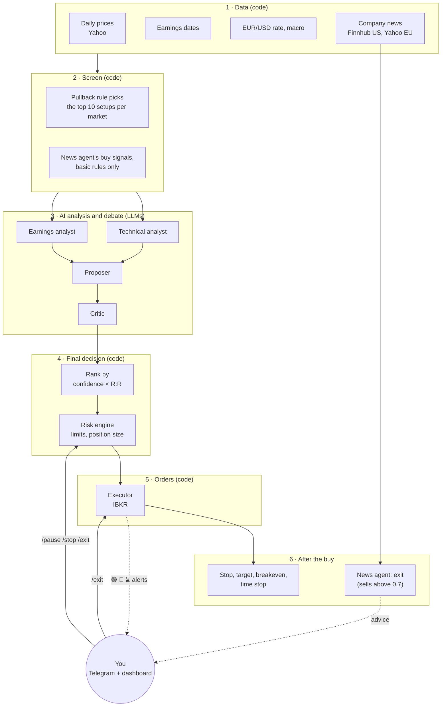
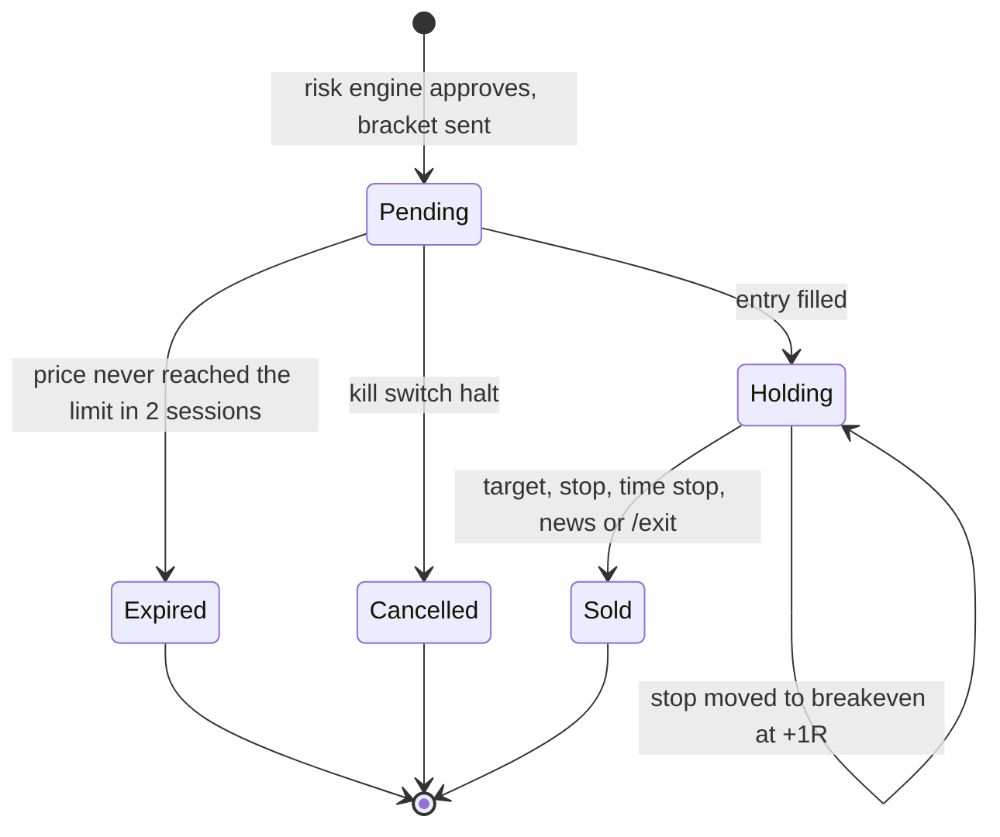
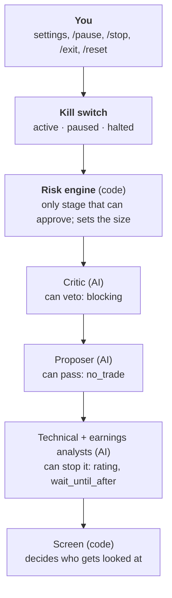

# How the Trading Agent Works

> A plain-language guide to what the system does, how it decides, and what happens when. How to run it is in [MANUAL.md](MANUAL.md); the code is in [CODE.md](CODE.md).
> The background documents are in [docs/design/](docs/design/): why it's designed this way ([CONCEPT.md](docs/design/CONCEPT.md)), how it was built ([IMPLEMENTATION.md](docs/design/IMPLEMENTATION.md)), the multi-agent design ([MAS-DESIGN.md](docs/design/MAS-DESIGN.md)) and AI tracing ([OBSERVABILITY.md](docs/design/OBSERVABILITY.md)).
> Not financial or tax advice.

---

## Contents

1. [The short version](#1-the-short-version)
2. [Trading words used in this guide](#2-trading-words-used-in-this-guide)
3. [The big picture](#3-the-big-picture)
4. [A trading day, hour by hour](#4-a-trading-day-hour-by-hour)
5. [End to end: from first data to a trade](#5-end-to-end-from-first-data-to-a-trade)
6. [When does it buy?](#6-when-does-it-buy)
7. [When does it sell?](#7-when-does-it-sell)
8. [The multi-agent system](#8-the-multi-agent-system)
9. [Start-up, background tasks, holidays, late starts, outages](#9-start-up-background-tasks-holidays-late-starts-outages)
10. [Does it work?](#10-does-it-work)
11. [Safety nets](#11-safety-nets)
12. [What the system does not do (yet)](#12-what-the-system-does-not-do-yet)

---

## 1. The short version

- The system is a **robot swing trader** for one personal account. It buys stocks it expects to rise over the next few days to three weeks, then sells them again. It never bets on falling prices (no short selling), never borrows money, and doesn't trade options.
- It watches about **140 large, liquid stocks**: the S&P 100 (US) and the DAX 40 (Germany).
- **Plain code** finds candidates with a fixed rule: "a stock in an uptrend that has dipped a little". A **News agent** adds stocks with a strong positive news catalyst. **AI models** (LLMs) then study each candidate, argue about it, and propose a trade or pass. The News agent also watches held stocks and sells one when the news breaks the reason it was bought.
- **Plain code has the final say.** A risk engine checks every proposal against hard limits and decides how many shares to buy. The AI can't place orders, choose the size, or invent prices.
- Every trade is placed with its exit already attached: a **stop** that sells if the price falls to a set level, and a **target** that sells if the price rises to a set level. They sit at the broker, so they still work if the computer is off.
- Every order goes to **IBKR** or nowhere: first the paper account (simulated money at IBKR), real money (€1,000, US stocks only) only once the paper results are good enough after all costs, over at least 3 months and 50 trades.
- You stay in control from your phone. Telegram brings a morning briefing, alerts and an evening digest. Commands like `/pause`, `/stop` and `/exit` let you step in at any time. The dashboard shows, for any day and any stock, every step with its inputs and outputs.

---

## 2. Trading words used in this guide

| Word | Meaning |
|---|---|
| **Swing trade** | A trade held for days to a few weeks, to catch one "swing" of the price. Day trading is shorter; investing is longer. |
| **Long** | Buying a stock to sell it later at a higher price. This system only goes long. |
| **Session** | One trading day of an exchange. NYSE (US): 15:30–22:00 Berlin time. Xetra (Germany): 09:00–17:30. |
| **Daily bar** | One day's summary of a stock: open, high, low and close price, plus volume (shares traded). The system works only with daily bars, not minute-by-minute prices. |
| **Limit order** | "Buy at this price or cheaper." If the price never gets there, nothing is bought. Every entry uses one. |
| **Stop (stop-loss)** | A standing order to sell if the price falls to a set level. It caps the loss of a trade. |
| **Target (take-profit)** | A standing order to sell if the price rises to a set level. It locks in the gain. |
| **Bracket order** | Entry, stop and target sent together. When one exit fills, the broker cancels the other. |
| **Risk (R)** | What you lose if the stop is hit: (entry − stop) × shares. "1R" is that amount. |
| **R multiple** | A result measured in units of risk. +2R means you won twice what you risked; −1R means the stop was hit. |
| **Reward to risk (R:R)** | (target − entry) ÷ (entry − stop). The system needs at least 2: the possible gain is at least twice the possible loss. |
| **Moving average (SMA, EMA)** | The average closing price over the last N days, for example SMA50 over 50 days. EMA weights recent days more. Rising averages, with the price above them, mean an **uptrend**. |
| **Pullback** | A short dip within an uptrend. Buying the dip is cheaper than buying at the top, and the stop can sit just below the dip. |
| **RSI** | Relative Strength Index, 0 to 100. Below 30 means the stock fell a lot recently ("oversold"), above 70 means it rose a lot ("overbought"). The setup wants 40–55: cooled off, but not collapsing. |
| **ATR** | Average True Range: how much the stock typically moves in a day, in currency. A stop closer than 1 ATR gets hit by normal noise. |
| **Support / resistance** | Price zones where the stock bounced (support) or stalled (resistance) before. |
| **Relative strength** | How a stock did over the last 3 months compared with its market (SPY for US, the DAX ETF for Germany). |
| **Earnings report** | A company's quarterly results. The price can jump 5–10 % overnight on them, which can skip right past a stop. The system avoids buying shortly before one. |
| **Drawdown** | How far the account has fallen from its highest value. |
| **Paper trading** | Trading with simulated money at IBKR (the paper account), using real prices. |
| **Slippage** | Getting a slightly worse price than planned. |
| **Settlement** | Money from a sale arrives one business day later in the US (T+1), two in Germany (T+2). Until then it can't buy anything. |
| **Win rate, expectancy, profit factor** | Share of winning trades; average result per trade (in R or €); total gains ÷ total losses. A profit factor above 1 means it made money. |
| **Book** | The record of the agent's trades at IBKR: `agent_paper` (paper account) or `agent_live` (real money). |
| **LLM** | Large language model, the AI behind chatbots. Here Google Gemini (and later Anthropic Claude) are used through their APIs. |

---

## 3. The big picture

What runs where:

| Part | Runs as | Uses AI? |
|---|---|---|
| Data collection, quality checks | Code | No |
| Screening for candidates | Code (fixed rules) | No |
| Analysis, proposal, critique | LLMs, checked by code after every answer | Yes |
| Ranking the proposals | Code (confidence × R:R) | No |
| Risk checks and position size | Code | **Never** |
| Orders, stops, exits | Code, talking to IBKR | **Never** |
| News: importance, buy signals, exits | LLM (News agent); code applies the thresholds | Yes |
| Briefing, digest | Code | No |

The whole system is one Python program (the `agent` container) plus a database, a read-only dashboard and the IB Gateway that talks to Interactive Brokers. It runs on the Zenbook at home. Every step of every stock is written to a **step log**, which the dashboard's **Day** page shows.

---

## 4. A trading day, hour by hour

Berlin time on a normal trading day (Xetra 09:00–17:30, NYSE 15:30–22:00). The source of truth is [config/schedule.yaml](config/schedule.yaml); Telegram `/status` shows the next jobs. The jobs follow the exchange calendars, so holidays and half-days are handled automatically (9.3).

| Time | Job | What happens | AI | Telegram | Dashboard |
|---|---|---|---|---|---|
| every 5 min | | Heartbeat ping to healthchecks.io, which e-mails you if the pings stop | | | |
| 00:05 | (planner) | Today's session jobs are planned from the exchange calendars | | | |
| 07:00 | `ingest_macro` | US macro data (FRED: yields, VIX, credit spreads, ...) and the ECB deposit rate | | | Day → Data freshness |
| 07:00, then every 30 min to 22:30 | `news_positions` | News on **held** stocks → News agent → exit or hold (5, step 10) | ✓ | 📰 important news, 🚪 news exit, 🧐 advice | Day → news column |
| 07:15 | `ingest_earnings` | Earnings dates and results (Yahoo) | | | |
| 07:45 | `news_eu` | News on every **German stock not held** → News agent → buy signals (5, step 3) | ✓ | 📰 buy signal | Day → news column |
| 08:15 | `scan_eu` | **EU scan**: screen + news candidates → technical → earnings → proposer → critic → rank → proposals (5, steps 3–7) | ✓ | 🧠 proposals | Day: screen to rank |
| 08:30 | `briefing` | Morning briefing: markets, EUR/USD, earnings ahead, the screen's setups, data status | | 📰 | |
| 09:00 | | Xetra opens | | | |
| 09:00, then every 10 min to 22:50 | `monitor` | IBKR sync: order states and fills into the book | | 🟢 bought, 🔴 sold, ⌛ entry ended | Day → order, fill; Portfolio |
| 09:15 | `place_eu` | **EU placement**: today's EU proposals in rank order → risk engine → bracket orders at IBKR (5, steps 8–9) | | 📤 placed and rejected | Day → risk, order |
| 14:15 | `news_us` | As at 07:45, for US stocks | ✓ | 📰 | |
| 14:45 | `scan_us` | **US scan**, as at 08:15 | ✓ | 🧠 | |
| 15:30 | | NYSE opens | | | |
| 15:45 | `place_us` | **US placement**, as at 09:15 | | 📤 | |
| 17:30 | | Xetra closes | | | |
| 18:00 | `ingest_eod_eu` | EU closing prices, ECB EUR/USD, data quality check | | ⚠️ newly blocked stocks | Day → Data freshness |
| 18:05 | `execution_eu` | **EU end of day**: IBKR sync, stop to breakeven / trailing, time stops, book, loss limits (5, step 10) | | 🟢 🔴 ⌛, ⏸ if a loss limit hit | Portfolio, Risk |
| 22:00 | | NYSE closes | | | |
| 22:30 | `ingest_eod_us` | US closing prices, data quality check | | | |
| 22:35 | `execution_us` | **US end of day**, as at 18:05 | | | |
| 22:40 | `reconcile` | IBKR positions vs. the book; any difference halts | | ⚠️ + ⛔ on a mismatch | Risk → kill switch |
| 23:05 | `evening_digest` | The day's proposals, orders, fills, sales, labels to do, AI spend | | 🌙 | |
| 23:45 | | IB Gateway restarts itself (2FA may be needed about once a week) | | 🔌 only if it stays down 10 min | |
| 03:15 | (host crontab) | Database backup | | | |

Why scan before the open and place 15 minutes after it? The scan uses the last complete daily bars, which exist once the previous session has closed. Placing after the open avoids the jumpy first minutes, and a placement that runs more than 2 minutes late is skipped rather than run at a random time.

---

## 5. End to end: from first data to a trade

### Step 1: Collect data

After each close, the system downloads that day's prices for every stock in the universe. Every number is stored with its source and time. Earnings dates, EUR/USD and macro data arrive each morning. A repeated download changes nothing; a stock split rewrites the stock's whole history automatically.

### Step 2: Check the data

Quality checks look for missing days, impossible prices (for example a low above the high), jumps over 40 % (often an unrecorded split), zero volume and stale data. A stock with a problem in the last 20 sessions is marked **blocked**, and you get a ⚠️ once per newly blocked stock. The screen skips blocked stocks, stocks without a bar for the latest session and stocks on the blacklist in `risk.yaml`.

### Step 3: Screen for candidates (code, no AI)

The "pullback in an uptrend" rule checks every stock on the latest daily bar. All of these must be true:

| Rule | In plain words |
|---|---|
| Price above 5 (USD or EUR) | No penny stocks |
| 20-day average traded value above 20 million | Enough trading that orders fill at fair prices |
| Close above the 200-day average, and the 50-day above the 200-day | The long-term trend is up |
| The highest close of the last 20 days was 3–10 days ago | It's a fresh dip, not a new high and not a long slide |
| Close 0–3 % above the 20-day EMA or the 50-day SMA | The dip has reached a level where buyers often step in |
| RSI between 40 and 55 | Cooled off, but not collapsing |
| No earnings report in the next 3 sessions | No overnight jump risk right after buying |

An optional **market filter** (off by default, [MANUAL.md](MANUAL.md) 9.5) skips the whole market while its index ETF trades below its 200-day average or the VIX is above a limit.

The stocks that pass are ranked by **relative strength** (the strongest over 3 months first). The **top 10 per market** go to the AI (5 in lean mode). Stocks the agent already holds are dropped.

**News candidates.** 30 minutes before the scan, the agent fetches the last 2 days of news for every stock in the market that it doesn't hold (Finnhub for US stocks, paced to 60 requests a minute; Yahoo for EU stocks). The News agent reads the stocks with new headlines, 8 per call, and answers `buy` or `none` per stock. A `buy` with confidence 0.6 or more (a clear, company-specific positive catalyst such as raised guidance) is stored as a buy signal for 24 hours (📰) and puts the stock into the scan, even if the pullback rule doesn't pass. Such a stock only needs the basic rules: fresh prices, price above 5, enough traded value, no report within 3 sessions, and the market filter. At most 3 news candidates per scan, most confident first. They go through the same analysts, proposer and critic, who also see the news (`catalyst`), and their proposals are marked `news`. Of these, **at most 1 is placed a day** (both markets together).

### Step 4: Analyse (two AI analysts)

For each candidate, code first computes all the facts: trend, moving averages, RSI, MACD, Bollinger Bands, volume, support and resistance zones, Fibonacci levels and ATR. From these it builds a **level menu**: named prices such as `ema20`, `sma50`, `swing_low_last`, `support_1`, `resistance_1`, `atr_stop_2x` or `atr_target_4x`.

- The **technical analyst** reads the facts and rates the setup (`strong_buy`, `buy`, `neutral`, `avoid`) with a draft plan. The plan names an entry, a stop and a target **from the menu**. It can't write a price of its own; an answer with a name that isn't on the menu is rejected.
- The **earnings analyst** looks at the next report and the last 8 (beat or miss, how far the price jumped). It decides whether a report falls inside the holding window (about 17 sessions) and gives a stance: no report in the window, hold through it, exit before it, or wait until after it.

After each answer, code checks it: the stop must be below the entry and the entry below the target; R:R at least 2; the stop 1–4 ATR below the entry. Any number in the text must also appear in the input, otherwise its confidence is capped at 0.5. If a check fails, the AI gets one more try with the errors explained. If it fails again, the answer is dropped. Answers already given for the same input are reused from the cache at no cost.

Only `buy` and `strong_buy` ratings continue.

### Step 5: Propose (the proposer)

The proposer sees both analyses, the level menu, the rules, what the agent already holds and a **market snapshot**: the index ETF's trend, its distance to the 200-day average and its 20-day return, the VIX now and 20 days ago, US credit spreads and interest rates (the FRED values need `FRED_API_KEY`; missing ones are empty). In a weak or nervous market it is told to demand a better setup and lower its confidence. It answers either **`no_trade`** with a reason, or **`propose`** with:

- entry, stop and target, again chosen by name from the menu
- a **thesis**: why it should work, in 2–4 sentences
- an **invalidation**: the price action that would prove it wrong
- a **confidence**: its probability that the target is hit before the stop. With R:R 2, a coin-flip setup is about 0.35; most setups are 0.3–0.5.

It must pass if the earnings analyst said "wait until after the report". The same code checks as in step 4 apply.

### Step 6: Challenge (the critic)

A second AI, meant to come from a different company (Claude, while the others are Gemini), plays devil's advocate. Code turns the level names into prices first, so the critic sees the real R:R and stop distance. It looks for reasons **not** to trade: a thesis the facts don't support, a weakening trend, a stop inside normal noise, a target beyond resistance, an earnings report, too much of one sector, missing data.

Each objection is `minor`, `major` or `blocking`. The critic also adjusts the confidence (from −0.5 to +0.1).

- **`blocking`**: the proposal is stored as `blocked` and is never traded.
- Otherwise it stays `proposed`, with the adjusted confidence.
- If the critic fails or is unavailable, the proposal stays `proposed` and is marked "no critique".

Until an Anthropic key is set up, the critic runs on Gemini too (`LLM_DEV_OVERRIDES=true`).

### Step 7: Rank (code)

The proposals that survive are put in order by **confidence × R:R**: the chance to reach the target times the reward per unit of risk. A proposal with confidence 0.5 and R:R 2.5 (score 1.25) comes before one with 0.6 and 2.0 (1.2). The rank step of each stock shows the numbers.

The proposals and every stock's steps are stored and summed up in Telegram (🧠). This is the end of the AI part; **no orders yet**.

### Step 8: Approve and size (the risk engine, code)

15 minutes after the open, the risk engine takes **today's** proposals for that market in rank order. Older proposals are never placed. If the IB Gateway isn't connected, each proposal gets the step "not placed: IBKR not connected", you get a 🔌 message, and nothing is placed. Otherwise it runs 9 checks per proposal; a single failure rejects the trade.

| # | Check | Passes when |
|---|---|---|
| 1 | Proposal | Its status is `proposed` (not blocked, not a pass) |
| 2 | Global | The kill switch is active (not paused or halted); in live mode the live interlock is satisfied; the market is open, outside its first 15 and last 10 minutes |
| 3 | Instrument | The market is allowed in this mode (live: US only); the stock is in the universe and not on the blacklist; price ≥ 5; average traded value ≥ 20 million; no earnings in the next 3 sessions |
| 4 | Levels | Stop < entry < target; R:R ≥ 2; stop 1–4 ATR below the entry; entry at most 1 % above the current price; the current price above the stop |
| 5 | Sizing | Some shares fit within all limits (fractions are fine), and the position is worth at least €100 |
| 6 | Fees | Estimated buy and sell fees are at most 10 % of the money at risk |
| 7 | Portfolio | Fewer than 8 positions and pending entries; the sector stays ≤ 60 % of the budget; stocks that move together (correlation above 0.7) stay ≤ 60 % together |
| 8 | Loss limits | Today's loss < 3 %, this week's < 6 %, drawdown < 15 % of the budget |
| 9 | Rate limits | Fewer than 8 orders today; the stock isn't already held or pending |

A news trade when one was already placed today is stopped before these checks.

The **position size** is the largest number of shares, down to 0.0001 of a share, that keeps all three limits:

$$
\text{shares} = \min\left(\frac{r \cdot \text{budget}}{\text{entry} - \text{stop}},\ \frac{p \cdot \text{budget}}{\text{entry}},\ \frac{\text{settled cash} - 10\% \cdot \text{budget}}{\text{entry}}\right)
$$

The risk share $r$ and the position share $p$ grow with the agents' **confidence** (the proposer's, adjusted by the critic). The conviction $c$ is 0 at a confidence of 0.30 or lower and 1 at 0.60 or higher, linear in between; $r = 0.75\% + c \cdot 0.75\%$ and $p = 10\% + c \cdot 15\%$. A proposal without a confidence gets $c = 0$.

In words, on a €1,000 budget: lose at most €7.50 (unsure) to €15 (sure) if the stop is hit, put €100 to €250 into one stock, and always keep €100 in cash. In paper mode the budget is €15,000, for both markets together.

### Step 9: Place the order

An approved trade becomes a **bracket order** at IBKR:

- **Entry**: buy limit at the entry price, valid until the close of the next session (2 sessions in total). If the price doesn't come down to it, the order expires (⌛) and nothing happens.
- **Stop**: sell stop, good until cancelled, active once the entry fills.
- **Target**: sell limit, good until cancelled. Stop and target are linked: when one fills, the broker cancels the other.

Prices are rounded to the exchange's price steps, always in the safe direction: entry down, stop and target up. You get a 📤 summary of what was placed and what was rejected, and why.

Every order goes to the IBKR account the gateway is logged in to (the paper account first). There is no simulator. Each order carries a reference like `TA-AAPL-entry-1a2b3c4d` that you can search for in TWS, Client Portal and your statements; IBKR's answer, including any error message (for example a rejected fractional size), is stored with the order and shown on the Day page.

### Step 10: Manage the position

- **Every 10 minutes** in sessions, the agent reads IBKR's orders and fills, moves each bracket through its states (working, filled, exiting, closed, expired, cancelled) and sends 🟢 / 🔴 / ⌛.
- **Every 30 minutes**, the News agent reads new headlines on held stocks (and, once a day, any held stock with a report within 3 sessions). It gets the position (entry, stop, target, last closes, R now), the original thesis and invalidation, and earlier news. Per stock it answers `exit` or `none` with a confidence. `exit` with 0.7 or more → market sell at IBKR now (at the next open if the market is closed) → 🚪, later 🔴 `(news)`. Below 0.7 → 🧐 advice with `/exit SYMBOL`; nothing is sold. An important headline → 📰.
- **After each close** (end of day), for each filled position of that market: held 15 sessions → market sell at the next open (time stop); high reached +1R → stop to the entry price (breakeven); optionally an ATR trailing stop. Stops only ever move up; the new stop is sent to IBKR. Then the book is rebuilt from the brackets and fills, the account value is stored, and the loss limits are checked at the close (a day's loss of 3 % pauses new entries through the next session, a week's loss of 6 % until Monday, a drawdown of 15 % halts).

Without an IBKR connection no stop is moved and no exit is sent (🔌); the book is still rebuilt.

### Worked example

A US stock closed at $100.00 and typically moves $2.50 a day (ATR). EUR/USD is 1.10, so a €1,000 budget is $1,100.

1. The screen finds it: uptrend, dipped for 5 days, now 1 % above its 20-day EMA, RSI 47.
2. The technical analyst rates it `buy`: entry `ema20` = $99.50, stop `swing_low_last` = $94.50, target `resistance_1` = $109.50.
3. The earnings analyst finds no report in the next 17 sessions.
4. The proposer agrees with that plan, confidence 0.40, invalidation "close below swing_low_last".
5. The critic notes a `minor` objection (volume is light) and lowers the confidence by 0.02.
6. The risk engine checks it:
   - R:R = (109.50 − 99.50) ÷ (99.50 − 94.50) = 10 ÷ 5 = **2.0** ✓
   - Stop distance = 5 ÷ 2.50 = **2 ATR** ✓ (allowed: 1–4)
   - Entry $99.50 is below the $100 price ✓
   - Size: risk limit $16.50 ÷ $5 = 3.3; position limit $330 ÷ $99.50 = 3.3; cash limit $990 ÷ $99.50 = 9.9 → **3 shares**
   - Position $298.50 ≈ €271 ✓; at risk 3 × $5 = $15 ≈ €13.60
   - Fees about $0.75 for buy and sell, 5 % of the risk ✓ (allowed: 10 %)
7. Order: buy 3 at $99.50 limit, stop $94.50, target $109.50.

What can happen next:

| Outcome | Result |
|---|---|
| The price never dips to $99.50 within 2 sessions | ⌛ Entry expires; nothing bought |
| Bought; the price falls to $94.50 | 🔴 Sold by the stop: −$15 (−1R) plus fees ≈ −€14 |
| Bought; the price rises to $109.50 | 🔴 Sold at the target: +$30 (+2R) minus fees ≈ +€27 |
| Bought; the price reaches $104.50 (+1R), then falls back | The stop moved up to $99.50 that evening, so it sells at about the entry price: roughly zero, minus fees |
| Bought; neither stop nor target hit within 15 sessions | Sold at the next open, whatever the price |

Because a win (+2R) is twice the size of a loss (−1R), the system makes money if a bit more than one trade in three reaches its target, before costs.

---

## 6. When does it buy?

The system buys a stock only if **all** of the following are true:

1. It's in the universe (S&P 100 or DAX 40), it has a price bar for the latest session, and the agent doesn't hold it yet.
2. The rule-based screen found a pullback in an uptrend on the last daily bar, and it ranked in the top 10 of its market. **Or** the News agent gave it a buy signal (confidence 0.6 or more) in the last 24 hours, it passed the basic rules, and it ranked in the top 3 news candidates.
3. The technical analyst rated it `buy` or `strong_buy` with a valid plan.
4. The earnings analyst didn't say "wait until after the report".
5. The proposer proposed it.
6. The critic didn't block it.
7. The risk engine approved it that morning, 15 minutes after the open (all 9 checks), and the IB Gateway was connected.
8. During that session or the next one, the price dipped to the entry limit.

If several proposals pass, they are placed in rank order (confidence × R:R) until the limits are reached (8 positions, 8 orders a day, sector and cash limits). Proposals from news candidates are limited to 1 placed a day.

---

## 7. When does it sell?

| Reason | How it works | Alert |
|---|---|---|
| **Target reached** | The target order at the broker sells when the price reaches it (at least 2R) | 🔴 target |
| **Stop hit** | The stop order at the broker sells when the price falls to it. If the stock opens below the stop after bad news, it sells at that worse price. | 🔴 stop |
| **Breakeven stop** | Once the daily high reaches entry + 1R, the stop is moved up to the entry price that evening. From then on the trade can't turn into a real loss (except for fees or a gap down). Stops only ever move up. | 🔴 stop |
| **Trailing stop** (optional, off) | With `trail_atr` set: after breakeven, every evening the stop moves up to the highest close since the entry minus that many ATRs. The target stays. | 🔴 stop |
| **Time stop** | After 15 sessions without hitting the stop or the target, it sells with a market order at the next open. Capital isn't tied up in a trade that isn't working. | 🔴 time |
| **You say so** | `/exit SYMBOL` in Telegram sells the whole position with a market order | 🔴 |
| **News exit** | The News agent says the news breaks the reason for the trade, with confidence 0.7 or more. A market order sells right away (at the next open if the market is closed). | 🚪 then 🔴 news |

What does **not** sell automatically:

- **Kill switch** (`/stop` or a loss limit): no new entries, and all unfilled entries are cancelled. Open positions **keep** their stops and targets, so they are still protected and can still reach the target.
- **A less certain news exit** (🧐): below 0.7 the News agent only tells you why and suggests `/exit SYMBOL`. The decision is yours.
- **Earnings ahead**: the system doesn't buy within 3 sessions of a report, and doesn't sell before one by rule. A report within 3 sessions makes the News agent look at the position once a day, which may lead to a news exit.

The dashboard's **Portfolio** page lists every sale with its reason, result and the whole timeline of the trade.

---

## 8. The multi-agent system

The project is also a showcase for a **multi-agent system (MAS)**: several independent decision-makers that each do one job and together reach a decision none of them makes alone. The design itself (architecture, communication, shared memory, coordination, trust, observability, evaluation) is in [MAS-DESIGN.md](docs/design/MAS-DESIGN.md).

### 8.1 The roles

| Role | Kind | Sees | Decides | Model (`config/models.yaml`) |
|---|---|---|---|---|
| Screen | Code | Daily bars of the whole universe | Which stocks are worth a look | none |
| News agent | LLM | New headlines (as untrusted text); for held stocks also the position facts and the original thesis | Importance per headline; `buy` (not held), `exit` (held) or `none`, with a confidence | `triage`: Gemini 3.1 Flash-Lite |
| Technical analyst | LLM | Computed indicators and the level menu | Rating, setup quality, a draft plan | `analysis`: Gemini 3.8 Flash |
| Earnings analyst | LLM | Next report, last 8 reports and price reactions | Earnings stance | `analysis`: Gemini 3.8 Flash |
| Proposer | LLM | Both analyses, the menu, rules, holdings, market snapshot | Propose or pass; plan, thesis, confidence | `proposer`: Gemini 3.8 Flash |
| Critic | LLM, other vendor | The same facts plus the plan in prices | Objections, severity, confidence change | `critic`: Claude Sonnet 5.5 (Gemini until an Anthropic key exists) |
| Risk engine | Code | Proposal, account, market facts, limits | Approve or reject; number of shares | none |
| Executor | Code | Approved orders, IBKR's state | Places, syncs, moves stops, exits | none |

The AI roles don't chat freely with each other. Each runs once per stock in a fixed order, and gets the previous roles' answers as input. The order is fixed by code: `orchestrator.py` holds the whole day stage by stage (scan, place, monitor, end of day).

### 8.2 Who's the boss?

**The risk engine is the boss of every order, and you are the boss of the risk engine.**

Read it from the bottom up: a trade needs a "yes" at every level, and any level below the risk engine can stop it. The levels above can only narrow things further.

| Level | Can stop a trade? | Can force a trade? |
|---|---|---|
| Screen | Yes: a stock that isn't picked is never analysed | No |
| Analysts | Yes: a rating below `buy`, or "wait until after the report" | No |
| Proposer | Yes: `no_trade` | No |
| Critic | Yes: `blocking` | No |
| Risk engine | Yes: any of 9 checks | It approves, but only what the AI proposed, and only within the limits |
| Kill switch | Yes: paused or halted means no new entries | No |
| You | Yes: `/pause`, `/stop`, settings | No: there is no manual buy command. `/exit` is the only manual order. |

Why it is built this way:

- **The AI never touches money directly.** Code checks enforce it: the AI code can't even import the order code. The AI returns data; code turns it into an order only after the risk engine says yes.
- **The AI never invents prices.** It picks names from a menu of prices that code computed from real data. Code turns the names back into prices.
- **The AI never decides the size.** The number of shares comes only from the risk engine's formula.
- **Two vendors.** The critic should come from a different company than the proposer, so the two are less likely to make the same mistake.
- **News is treated as data, never as instructions.** Its text is wrapped and labelled as untrusted. A manipulated article saying "buy XYZ now" can at most put XYZ in front of the analysts, the proposer, the critic and the risk engine, all of which must agree, and only 1 news trade a day is placed. A news exit can only sell what is held.

### 8.3 What happens when an agent fails

| Failure | Effect |
|---|---|
| The technical analyst's or the proposer's answer fails the checks twice | That stock is skipped today |
| The critic fails | The proposal stays, marked "no critique" |
| The AI provider is down | Retries after 20 s and 60 s; then that stock is skipped today (🧠 lists it) |
| The AI budget is used up (100 %) | No more AI calls this month, so no scans, no news reading and no new trades |

---

## 9. Start-up, background tasks, holidays, late starts, outages

### 9.1 Start-up

`make up` builds the image, updates the database and starts four containers ([MANUAL.md](MANUAL.md) 5.1). `db` and `dashboard` also come back by themselves after a reboot; `agent` and `ib-gateway` never do.

| # | What | You see |
|---|---|---|
| 1 | `db` (PostgreSQL) starts and reports healthy; the agent waits for it | |
| 2 | `ib-gateway` starts and logs in to the IBKR paper account (30–90 s; possibly a 2FA prompt on your phone) | `docker compose logs ib-gateway`: `Login has completed` |
| 3 | The agent reads `.env`, the secrets and `config/*.yaml`, sets up logging and tracing | |
| 4 | It writes `agent.started` to the audit log and syncs `config/universe.yaml` into the database (new stocks added, removed ones deactivated) | log `universe.synced` |
| 5 | It sets up the agents and data sources and starts the Telegram bot | |
| 6 | It starts the IBKR link in the background. Once connected: contract ids for new stocks, then a **reconciliation** (IBKR positions vs. the book; any difference halts trading) | log `ibkr.connected`, `reconcile.done`; ⚠️ on a mismatch |
| 7 | It plans the jobs: fixed-time jobs and today's session jobs from the exchange calendars | log `scheduler.planned` |
| 8 | It sends ▶️ to Telegram | `▶️ Agent started (paper), kill switch active` |

The dashboard only reads the database and works whether the agent runs or not.

### 9.2 Always running in the background

| What | How often | You see |
|---|---|---|
| Heartbeat ping to healthchecks.io | every 5 min | an e-mail if pings stop for 20 min |
| IBKR connection check, reconnect with backoff (30 s up to 5 min) | every 30 s | 🔌 after 10 min down, 🔌 again when it's back; every reconnect runs contract ids and the reconciliation |
| Telegram commands and buttons | whenever you send one | the answer |
| Job watchdog | on every job | ⚠️ `Job X failed: ...` or `Job X missed its run time and was skipped` |
| Planning the day's session jobs | 00:05 every night (and at start) | log `scheduler.planned` |
| IB Gateway's own restart | 23:45 every night | a short disconnect; the agent reconnects and reconciles |

### 9.3 Weekends, holidays, half-days, summer time

- **Weekends**: nothing runs except the heartbeat and the IBKR link (and the gateway's restart).
- **Holidays**: session jobs (news before the scan, scan, placement, end of day, digest, reconciliation) follow each exchange's calendar and don't run when that exchange is closed. On a German holiday with NYSE open, only the US jobs run, and the other way round. The morning briefing is skipped when both are closed.
- **Half-days**: jobs anchored to the close move with it.
- **Summer time**: Europe and the US switch on different dates. For one to three weeks in spring and autumn, all US jobs run one hour earlier in Berlin time (e.g. the US scan at 13:45). Nothing to do.
- Fixed-time jobs (`ingest_macro`, `ingest_earnings`, `briefing`, `monitor`, `news_positions`) run Monday to Friday.

### 9.4 Starting late, stopping, restarting

**Start before 07:45** on a trading day to get the full EU day, and before 14:15 for the full US day. Each job has a grace time; a job whose time passed longer ago than that is skipped and reported once as ⚠️ "missed":

| Job | Runs late if started within | Otherwise |
|---|---|---|
| `place_eu`, `place_us` | 2 min | Skipped: no orders that day for that market. Today's proposals are never placed later. |
| `news_positions` | 20 min | The next half-hour run catches up |
| `news_eu`, `news_us` | 25 min | Skipped; the scan runs without news candidates |
| `scan_eu`, `scan_us` | 30 min | Skipped: no proposals, so no orders that day for that market |
| `briefing` | 60 min | Skipped |
| `monitor` | 5 min | The next run catches up |
| Data jobs, end of day, reconciliation, digest | 6 hours | Run late |

**Stop** (`make down`): the agent sends ⏹, stops the jobs, disconnects from IBKR and writes `agent.stopped` to the audit log. Orders already at IBKR (buy limits, stops, targets) **stay active there**, but nothing watches them, moves stops or sells by time stop or news.

**Restart** (after an update or a crash): `make up`. On reconnect the agent reconciles with IBKR; fills that happened while it was down are picked up by the next sync, because it compares IBKR's filled quantities with its own.

### 9.5 When something is down

| What's down | Effect | You see |
|---|---|---|
| IB Gateway / IBKR | No placements (an error step per proposal), no stop moves, no time stops, no news exits; stops and targets already at IBKR keep working; scans, news reading and data jobs continue | 🔌 after 10 min; 🔌 per skipped placement, end of day or news exit |
| Internet | All outside calls fail; the jobs report errors | ⚠️ per failed job; heartbeat e-mail after 20 min |
| A data source (Yahoo, ECB, FRED, Finnhub) | That job reports a failure; the others continue. Stale prices block the affected stocks from the scan | ⚠️ |
| AI provider | Retries; then that stock is skipped today | 🧠 lists skipped stocks |
| AI budget used up | No AI calls until next month | `/budget`, 🧠 empty |
| Telegram | Messages are logged instead; trading continues | nothing in Telegram; `make logs` |
| The Zenbook | Nothing runs; stops and targets at IBKR keep working | heartbeat e-mail after 20 min |
| A kill switch is on (paused or halted) | No new entries; held positions keep their stops and targets; a halt also cancels unfilled entries | ⏸ / ⛔, `/status` |

---

## 10. Does it work?

Nobody knows yet whether the AI adds value. Public studies of AI trading agents are sobering, and the rule-based strategy alone showed **no edge** in a 5-year backtest: roughly break-even before costs, slightly negative after fees, far behind simply holding the index ([IMPLEMENTATION.md](docs/design/IMPLEMENTATION.md) 6.3).

The answer comes from the real trades only: `agent_paper` holds every order the agent sent to the IBKR paper account and every fill IBKR reported. The dashboard shows its results after fees and AI costs, and your agree/disagree labels (`/review`) next to the outcomes. `agent_live` is the same for real money, later.

---

## 11. Safety nets

| Safety net | What it does |
|---|---|
| **Stops at the broker** | Every position has a stop and a target at IBKR from the moment it's bought, so a crash, a power cut or a reboot never leaves a position unprotected. |
| **Hard limits in code** | Risk per trade, position size, 8 positions, a cash reserve, sector and correlation caps, 8 orders a day ([MANUAL.md](MANUAL.md) 9.3). AI output can't change them. |
| **Loss limits** | Down 3 % on a day: no new entries the next trading day. Down 6 % this week: none until Monday. Down 15 % from the peak: **halt**. Measured every evening after the close, with a Telegram message, and checked again before each new trade. |
| **Kill switch** | Three states: **active** (normal), **paused** (no new entries; via `/pause` or a daily or weekly loss limit), **halted** (no new entries, all unfilled entries cancelled; via `/stop`, the drawdown limit or a reconciliation mismatch). |
| **Reset needs two keys** | A halt only ends with a code printed on the host (`trading-agent reset`), sent from your phone with `/reset CODE` within 15 minutes. |
| **Reconciliation** | Compares IBKR's positions with the agent's book after each US close and after every reconnect. Any difference halts the agent. |
| **IBKR or nothing** | No simulator: while the gateway is disconnected nothing is placed, and the step log and Telegram say so. |
| **Live interlock** | Real money needs three things at once: `APP_MODE=live`, a live IBKR login, and `/confirm_live CODE` with a code from the host logs after every start. Without all three, no orders. Paper mode on a live login is refused too. |
| **AI budget** | Monthly cap of $16 (about €15). Fewer candidates above 80 %, no calls at 100 %. A model without a known price is never called. |
| **Owner-only Telegram** | Messages from any other chat are ignored and logged. Messages never contain account numbers or passwords. |
| **Read-only dashboard** | It can't change anything, uses a read-only database login, and is reachable only through your Tailscale network. |
| **Heartbeat** | An outside service alerts you if the agent stops pinging. |
| **Backups** | Nightly database dump, a weekly encrypted copy for off-site storage, and a tested restore. |
| **Audit trail** | Every AI prompt and answer, every step of every stock, every risk decision with all checks, every order change and every kill-switch change is stored. |

---

## 12. What the system does not do (yet)

- **No short selling, no margin, no options.** Only buying shares with cash.
- **No intraday trading.** Decisions use daily bars; stops and targets at the broker react during the day, but breakeven and time stops are set in the evening.
- **No trailing stop by default** beyond the one move to breakeven (`trail_atr` can switch one on).
- **No automatic sale before earnings by rule.** The News agent looks at such positions and may exit on news.
- **Macro data only informs the proposer** (and the optional market filter). Company fundamentals (revenue, valuation) aren't used.
- **News is headlines only**, a few times a day: Finnhub for US stocks (free tier), Yahoo for EU stocks (unofficial, latest headlines only).
- **The 1 % entry check uses a delayed price** (15–20 minutes old), or the last close when no quote arrives. Real-time prices would need a paid market-data subscription.
- **No proven edge.** The whole point of the paper phase is to find out whether there is one.
